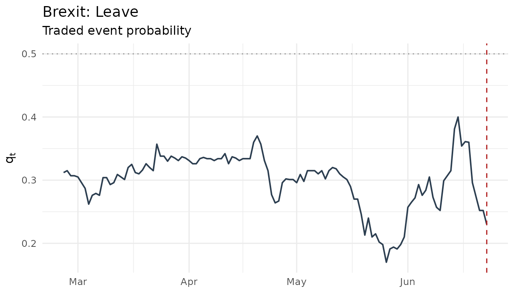
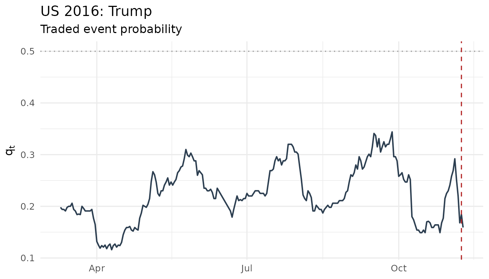
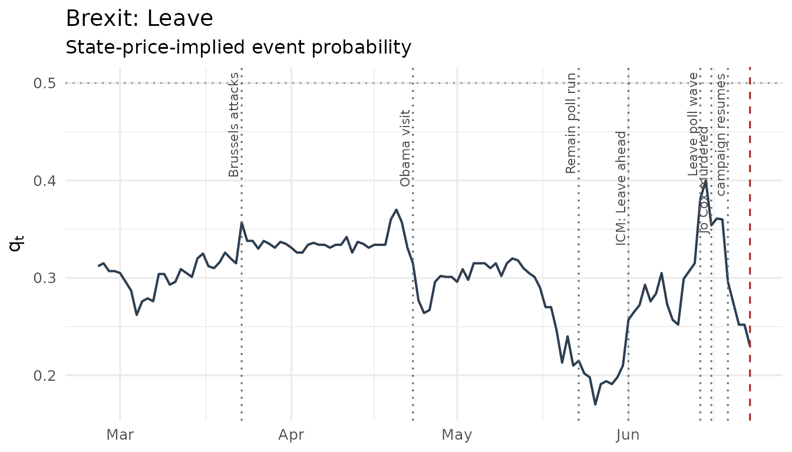
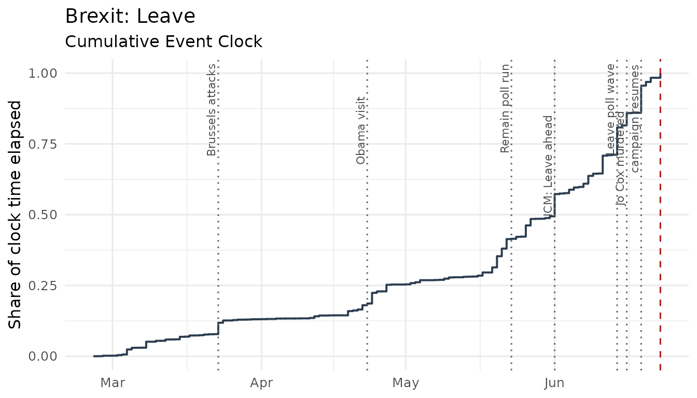
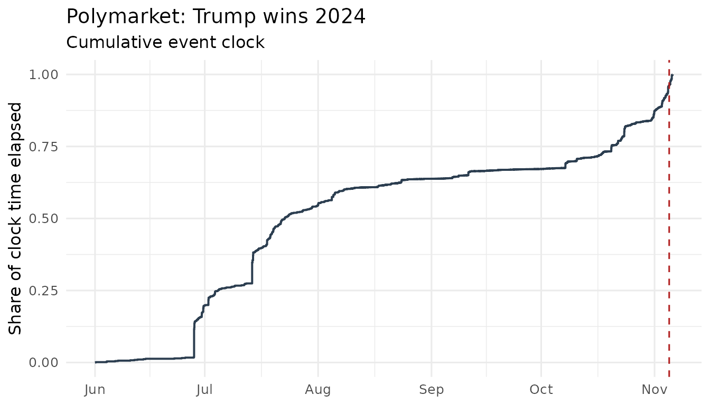
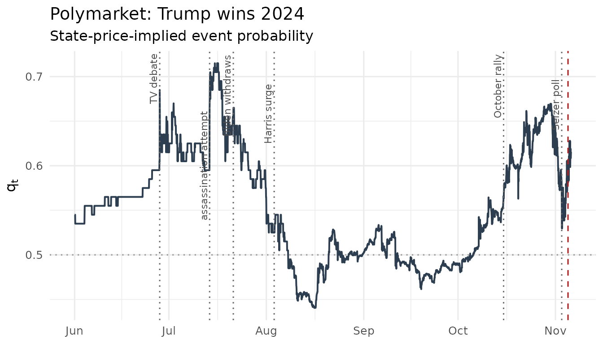
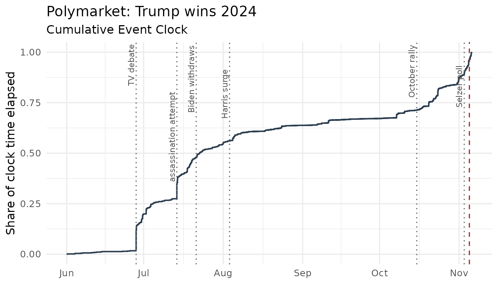
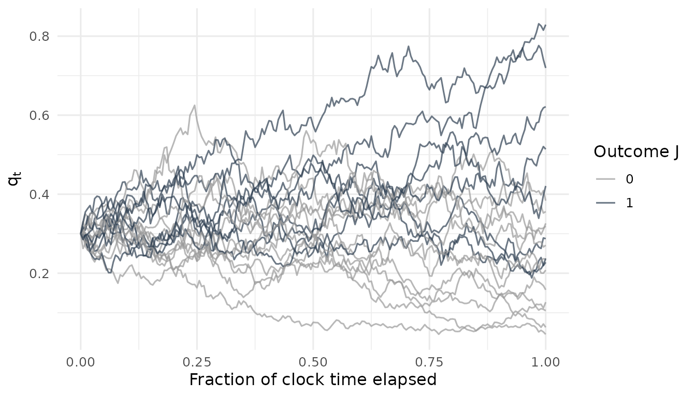

# Getting started: the Event Clock for Brexit, the 2016 U.S. election, and Polymarket

``` r

library(eventclock)
```

## What this package measures

Before a scheduled event — a referendum, an election, a central-bank
decision, a court ruling — markets learn. Polls come out, news breaks,
and the price of a contract that pays out if the event happens moves up
and down. The **Event Clock** measures *how much* outcome-relevant news
arrived over any period, and *when*. A week of big, frequent revisions
is a week of lots of news; a flat week is a week of none. Measuring this
matters whenever something is priced before the event: an option that
expires before an election is exposed to the news that will arrive while
it is alive, not to the election result itself.

**What you need:** a time series of an event probability between 0 and 1
— a prediction-market price, a betting quote, a probability implied by
fed funds futures or a merger spread — with a date or timestamp.

**What you get:** how much news arrived over any window and when, robust
variants that separate big news days from steady flow, real-time
forecasts of the news still to come, and closed-form calculators for
option and risk questions.

### Key terms

- **Event probability \\q_t\\.** The traded price of a contract paying 1
  if the event happens. After removing discounting it is a probability
  as priced by the market — which may include risk premia, so it need
  not equal anyone’s belief. (In the papers: the *state-price-implied
  event probability*.)
- **Log odds \\L_t = \log\\q_t/(1-q_t)\\\\.** The probability on a scale
  where a move from 50% to 60% and a move from 89% to 92% count about
  the same.
- **Event Clock \\A\_{t,T}\\.** The amount of news between \\t\\ and
  \\T\\, also called *event-clock time*. The package estimates it as the
  sum of squared log-odds changes, \\\widehat A\_{t,T} \\=\\ \sum\_{t_i
  \in \[t,T)} \bigl\[L\_{t\_{i+1}} - L\_{t_i}\bigr\]^2 ;\\ technically,
  the quadratic variation of the log odds. Below, \\A\\ denotes both the
  clock and its estimate when no confusion arises.

## Two classic event windows: Brexit and the 2016 U.S. election

The package ships two daily event-probability series derived from
betting quotes: the 2016 Brexit referendum and the 2016 U.S.
presidential election (see
[`?brexit2016`](https://www.sebastianstoeckl.com/eventclock/reference/brexit2016.md)).
[`as_event_prices()`](https://www.sebastianstoeckl.com/eventclock/reference/as_event_prices.md)
turns any data frame with a time column and a probability column into
the package’s standard format; `event_date` records when the event
resolves (used for plots and windows). Before taking log odds,
probabilities are clipped to \[0.01, 0.99\] by default, because log odds
explode near 0 and 1.

``` r

data(brexit2016)
data(us2016)

ep_gb <- as_event_prices(brexit2016,
  time = "date", price = "q_leave",
  market_id = "Brexit: Leave", event_date = as.Date("2016-06-23")
)
ep_us <- as_event_prices(us2016,
  time = "date", price = "trump",
  market_id = "US 2016: Trump", event_date = as.Date("2016-11-08")
)

plot_q(ep_gb)
```



``` r

plot_q(ep_us)
```



What to look at: Leave hovered between 20% and 40% and lurched in June;
Trump spent most of 2016 between 15% and 35% — markets were surprised by
both outcomes.

### Screening the series first

[`ec_validate()`](https://www.sebastianstoeckl.com/eventclock/reference/ec_validate.md)
reports coverage, stale stretches, the smallest price move (tick), gaps,
and the largest moves. It changes nothing — it only flags:

``` r

ec_validate(ep_gb)
#> -- Event-price data-quality report: Brexit: Leave
#> Coverage:  119 obs, 2016-02-26 to 2016-06-23, median spacing 1 days, 0 NA
#> Clipping:  0.0% of observations outside the clipping bounds
#> Staleness: 11.0% zero increments, longest stale run 2 obs
#> Tick:      smallest non-zero move 0.001
#> Gaps:      0 gap increment(s), largest 1 days
#> Outliers:  max |dL| = 0.292 (5.5 robust SDs)
```

The largest log-odds move is far out in the tails relative to a typical
day — but it is genuine news (the June 10–14 Leave poll wave, see
below), which is why the package flags rather than drops. (The “robust
SDs” here are measured over the full sample; the truncated estimator
below measures them within each window, where big days are more common.)

### Other sources of event probabilities

Any traded event price can feed the clock. Three converters ship with
the package:

``` r

# a contract price, discounted to a probability (here: 0.5% discount)
q_from_price(c(0.45, 0.52), discount = 0.995)
#> [1] 0.4522613 0.5226131

# fed funds futures: the September 2024 FOMC meeting, pre-meeting rate
# 5.33%, a hypothetical futures price of 94.74, probability of a 25bp cut
q_from_ffutures(94.74, pre_rate = 5.33,
                meeting_date = as.Date("2024-09-18"), step = -0.25)
#> # A tibble: 1 × 5
#>   meeting_date implied_avg implied_post delta_rate     q
#>   <date>             <dbl>        <dbl>      <dbl> <dbl>
#> 1 2024-09-18          5.26         5.16     -0.175 0.700

# merger arbitrage: probability that a deal at 50 closes, if the stock
# would fall back to 35 without it
q_from_deal_spread(c(40, 44, 48.5), offer = 50, fallback = 35)
#> [1] 0.3333333 0.6000000 0.9000000
```

The fed funds converter uses the standard month-average extraction (the
future settles on the average rate over the month, so the price mixes
the rate before and after the meeting day); the merger converter is \\q
= (\text{price} - \text{fallback})/(\text{offer} - \text{fallback})\\.
Meeting dates are in `fomc_meetings`.

## How much news arrived?

Pick a *valuation date* — the day you stand on and look forward from;
here one month before each vote (May 24 and October 10, 2016) — and add
up the clock to one week, two weeks, and the event. Besides the plain
sum, the package reports robust variants that show how much came from a
few big news days:

- `rv` — the plain sum of squared log-odds changes (the baseline);
- `truncated` — drops changes larger than 3 robust standard deviations
  (median absolute deviation, within the window);
- `bipower` — uses products of neighboring absolute changes, which an
  isolated jump barely affects;
- `largest1`, `largest2` — the plain sum without the one or two largest
  changes.

``` r

gb <- event_clock(ep_gb,
  from = as.Date("2016-05-24"),
  to = c(`1W` = as.Date("2016-05-31"), `2W` = as.Date("2016-06-07"),
         `1M` = as.Date("2016-06-23"))
)
us <- event_clock(ep_us,
  from = as.Date("2016-10-10"),
  to = c(`1W` = as.Date("2016-10-17"), `2W` = as.Date("2016-10-24"),
         `1M` = as.Date("2016-11-08"))
)

tab <- rbind(
  cbind(case = "Brexit", as.data.frame(gb[, c("horizon", "method", "A")])),
  cbind(case = "U.S. election", as.data.frame(us[, c("horizon", "method", "A")]))
)
knitr::kable(
  stats::reshape(tab,
    idvar = c("case", "horizon"), timevar = "method", direction = "wide"
  ),
  digits = 3, row.names = FALSE,
  col.names = c("Case", "Horizon", "RV", "Truncated", "Bipower",
                "Largest-1", "Largest-2")
)
```

| Case          | Horizon |    RV | Truncated | Bipower | Largest-1 | Largest-2 |
|:--------------|:--------|------:|----------:|--------:|----------:|----------:|
| Brexit        | 1W      | 0.064 |     0.064 |   0.060 |     0.029 |     0.009 |
| Brexit        | 2W      | 0.166 |     0.166 |   0.141 |     0.096 |     0.062 |
| Brexit        | 1M      | 0.510 |     0.510 |   0.374 |     0.425 |     0.341 |
| U.S. election | 1W      | 0.015 |     0.015 |   0.011 |     0.010 |     0.005 |
| U.S. election | 2W      | 0.046 |     0.046 |   0.025 |     0.021 |     0.016 |
| U.S. election | 1M      | 0.370 |     0.259 |   0.386 |     0.259 |     0.200 |

Reading the table: over the final month, the Brexit clock reached 0.510,
against 0.370 for the U.S. election, and 68% of the Brexit month’s news
arrived after June 7, in the last two and a half weeks. Dropping the
single largest day removes 17% of the Brexit month: news arrived in a
few big bursts. For the U.S. month the truncation rule removes exactly
the largest move, so `truncated` equals `largest1`; for Brexit, where
big days were common in June, the largest move stays inside the 3-SD
threshold. With daily data and short windows, compare both.

Windows are *anchored* (from the valuation date to each horizon), and
observations are calendar-daily including weekends.

## The clock over time

The most instructive object is not a single number but the *path* — when
did the news actually arrive?
[`event_clock_path()`](https://www.sebastianstoeckl.com/eventclock/reference/event_clock_path.md)
returns the cumulative clock and each day’s contribution `dA`; ranking
the days by `dA` finds the news days.

``` r

events_gb <- data.frame(
  date = as.Date(c(
    "2016-03-23", "2016-04-23", "2016-05-23", "2016-06-01",
    "2016-06-14", "2016-06-16", "2016-06-19"
  )),
  label = c(
    "Brussels attacks", "Obama visit", "Remain poll run", "ICM: Leave ahead",
    "Leave poll wave", "Jo Cox murdered", "campaign resumes"
  )
)

path_gb <- event_clock_path(ep_gb)
mark_events(plot_q(ep_gb), events_gb)
```



``` r

mark_events(plot_clock(path_gb), events_gb)
```



(`mark_events()` is a small plotting helper defined in this vignette’s
source, not a package function.) The biggest single-day contributions:

``` r

head(path_gb[order(-path_gb$dA), c("time", "dL", "dA")], 7)
#> # A tibble: 7 × 3
#>   time           dL     dA
#>   <date>      <dbl>  <dbl>
#> 1 2016-06-14  0.292 0.0850
#> 2 2016-06-19 -0.291 0.0847
#> 3 2016-06-01  0.263 0.0693
#> 4 2016-06-11  0.236 0.0557
#> 5 2016-06-16 -0.196 0.0384
#> 6 2016-03-23  0.188 0.0355
#> 7 2016-05-20 -0.187 0.0349
```

The steps of the cumulative clock have names — they are the campaign’s
news days (`dL` is the log-odds move of the *Leave* probability; some
news spans two adjacent days):

- **Mar 22–23** — Brussels terror attacks; Leave odds jump
  (`dL = +0.19`).
- **Apr 22–24** — Obama’s London visit (“back of the queue”); Remain
  boost (`dL = -0.18`).
- **May 20–26** — the Remain poll run (ORB Remain +15, Treasury/IMF
  warnings); `q_leave` hits its sample low of 0.17.
- **May 31 – Jun 1** — paired ICM phone/online polls put Leave ahead:
  the campaign’s turning point (`dL = +0.26`, 8% of the full-sample
  clock).
- **Jun 10–14** — the Leave poll wave plus The Sun’s endorsement — the
  single largest step (`dL = +0.29`, 10%).
- **Jun 16** — the murder of Jo Cox; campaigning is suspended
  (`dL = -0.20`).
- **Jun 19–20** — campaigning resumes, Remain recovers in the weekend
  polls (`dL = -0.29`, 10%).

``` r

plot_clock_vs_calendar(path_gb)
```



This plot sets the share of the clock elapsed against the share of
calendar time elapsed. A path below the 45-degree line means information
is back-loaded — it waits for the deadline; the June cluster of poll
shocks is the late steep segment.

## Real time versus after the fact

Looking back, we know how much news arrived while an option was alive.
On the day the option is priced we do not, so we need a forecast:
measure how fast the clock has been ticking recently and scale that
speed to the horizon, using only prices observed up to that day. How far
back “recently” reaches is chosen by forecast accuracy on *earlier*
periods. Here, every one-week window starting between May 15 and October
3 serves as a test case (all end before the October 10 valuation date),
and three window lengths compete; `obs` counts observations, so 61
observations are the last 60 daily changes:

``` r

starts <- seq(as.Date("2016-05-15"), as.Date("2016-10-03"), by = "day")
sel <- ec_forecast_select(ep_us,
  intervals = data.frame(start = starts, end = starts + 7),
  rules = ec_forecast_rules(obs = c(21, 41, 61)))
sel$best$rule
#> [1] "trailing 61 obs / rv"

fc <- event_clock_forecast(ep_us,
  at = as.Date("2016-10-10"),
  horizon = c(`1W` = 7, `2W` = 14),
  trailing = 61
)
fc[, c("horizon", "rate_per_day", "A_forecast")]
#> # A tibble: 2 × 3
#>   horizon rate_per_day A_forecast
#>   <chr>          <dbl>      <dbl>
#> 1 1W           0.00682     0.0478
#> 2 2W           0.00682     0.0955
```

Extrapolating the speed of the last 60 days gave 0.048 of clock time for
the next week — about 3 times the 0.015 that actually arrived; the news
came in the final two weeks instead. Sampling frequency, forecast
selection, and comparisons across trading venues are covered in
[`vignette("eventclock-measurement")`](https://www.sebastianstoeckl.com/eventclock/articles/eventclock-measurement.md).

## Why levels and risk premia do not matter

Discounting and risk premia shift the *level* of a traded probability,
but such shifts change slowly; the clock adds up squared *changes*, so a
slowly varying shift contributes almost nothing. On May 24 the raw
betting probability of Leave was 0.202. The working paper re-expresses
it as the price of a contract paying one U.S. dollar if Leave wins
(betting stakes are in pounds, and the pound itself depends on the
vote), which gives 0.195. The two differ by an almost constant shift in
log odds — and a constant shift has no changes, so it adds nothing to
the clock:

``` r

shifted <- brexit2016
shifted$q_leave <- ec_ilogit(ec_logit(brexit2016$q_leave) + 0.5)
ep_shift <- as_event_prices(shifted, time = "date", price = "q_leave")

c(
  original = event_clock(ep_gb, from = as.Date("2016-05-24"),
                         methods = "rv")$A,
  shifted = event_clock(ep_shift, from = as.Date("2016-05-24"),
                        methods = "rv")$A
)
#> original  shifted 
#> 0.510469 0.510469
```

What the clock cannot rule out is that the market’s *relative* valuation
of the two outcomes fluctuates on its own, day to day. If at most a
fraction \\\delta^2\\ of the measured clock came from such re-valuation,
the true news clock lies between \\(1-\delta)^2\\ and \\(1+\delta)^2\\
times the measured one;
[`ec_recovery_set()`](https://www.sebastianstoeckl.com/eventclock/reference/ec_recovery_set.md)
tabulates this range (\\\delta = 0\\ means the measured clock is all
news):

``` r

A_1m <- gb$A[gb$horizon == "1M" & gb$method == "rv"]
ec_recovery_set(A_1m, delta = c(0, 0.25, 0.5))
#> # A tibble: 3 × 4
#>       A delta lower upper
#>   <dbl> <dbl> <dbl> <dbl>
#> 1 0.510  0    0.510 0.510
#> 2 0.510  0.25 0.287 0.798
#> 3 0.510  0.5  0.128 1.15
```

## The formula book

Once \\q\\ and \\A\\ are known, many questions have closed-form answers.
They all follow from one transition law for the log odds at a later date
\\T\\, \\L_T = L_t + \bigl(J - \tfrac12\bigr) A + \sqrt{A}\\\zeta ,\\
where \\J = 1\\ if the event happens and \\0\\ otherwise, \\\zeta\\ is a
standard normal shock, and \\A\\ is the clock time between \\t\\ and
\\T\\: given the eventual outcome, the log odds drift toward it by
\\A/2\\ and fluctuate with variance \\A\\. The worked Brexit example
uses the two-week window from May 24 with the working paper’s inputs:
\\q = 0.195\\ (the dollar-based Leave probability; the shipped betting
series gives 0.202) and \\A = 0.166\\.

Units used by the calculators:

| Input | Meaning | Unit |
|----|----|----|
| `q` | event probability today | 0–1 |
| `A` | clock time between today and the horizon | log-odds variance |
| `sigma`, `tenor` | ordinary (no-event) volatility and time to expiry, in [`ec_iv_rule()`](https://www.sebastianstoeckl.com/eventclock/reference/ec_iv_rule.md), [`ec_relevance()`](https://www.sebastianstoeckl.com/eventclock/reference/ec_relevance.md) and friends | annualized; years |
| `s_cf`, `s1`, `s2` | dispersions in the option functions of [`vignette("eventclock-event-spanning")`](https://www.sebastianstoeckl.com/eventclock/articles/eventclock-event-spanning.md) | total: volatility × \\\sqrt{\text{years}}\\ |

Pass arguments by name: the calculators do not all take them in the same
order.

``` r

# distribution of the probability and the log odds at June 7:
# E_qT = expected probability (always today's q), sd_LT = spread of
# the log odds, var_qT = variance of the probability
ec_moments(q = 0.195, A = 0.166)[, c("q", "A", "E_qT", "sd_LT", "var_qT")]
#> # A tibble: 1 × 5
#>       q     A  E_qT sd_LT  var_qT
#>   <dbl> <dbl> <dbl> <dbl>   <dbl>
#> 1 0.195 0.166 0.195 0.413 0.00409

# typical size of the revision by June 7: about 5 probability points
ec_revision(q = 0.195, A = 0.166)
#> [1] 0.05102989

# probability that Leave is above 50% on June 7
ec_exceedance(0.5, q = 0.195, A = 0.166)
#> [1] 0.0001951016

# clock time needed to move from 19.5% to "90% sure", in multiples of
# the two-week clock
ec_target_clock(q = 0.195, target = 0.9) / 0.166
#> [1] 43.55503
```

Even if Leave was going to win, its log odds drift up by only \\A/2\\
per unit of clock time, so reaching 90% takes \\A \approx\\ 7.2 — about
44 times the news of those two weeks, a reminder of how far markets were
from certainty.

**How much does learning add to option prices?** An asset whose value
differs between the outcomes moves with the probability. If its value
would be a fraction \\\Delta\eta\\ of today’s value higher if the event
happens than if it does not (the *exposure*, negative when the event
hurts the asset; see
[`vignette("eventclock-event-betas")`](https://www.sebastianstoeckl.com/eventclock/articles/eventclock-event-betas.md)),
learning adds roughly \\\[\Delta\eta\\ q(1-q)\]^2 A / (2\sigma\tau)\\ to
the implied volatility of an option with \\\tau\\ years to expiry, where
\\\sigma\\ is the asset’s annualized volatility without the event.
[`ec_iv_rule()`](https://www.sebastianstoeckl.com/eventclock/reference/ec_iv_rule.md)
computes this screen (the exact value is
[`ec_mix_iv_pre()`](https://www.sebastianstoeckl.com/eventclock/reference/ec_mix_price_pre.md),
see
[`vignette("eventclock-event-spanning")`](https://www.sebastianstoeckl.com/eventclock/articles/eventclock-event-spanning.md)).
The inputs below are the working paper’s option-implied values. For the
British pound, options priced its expected value only about 1.2% lower
under Leave than under Remain (exposure \\-0.012\\) — far less than the
8% fall that followed the vote; volatility without the event was 9.3%.
For the Mexican peso around the 2016 U.S. election, the exposure to a
Trump win was \\-0.099\\, with \\q = 0.172\\ on October 10 (the shipped
series gives 0.174) and volatility 19.3%. Over two weeks, in annualized
percentage points:

``` r

iv_pts <- c(
  pound_brexit_2w = 100 * ec_iv_rule(deta = -0.012, q = 0.195, A = 0.166,
                                     sigma = 0.09325, tenor = 14 / 365),
  peso_us2016_2w  = 100 * ec_iv_rule(deta = -0.099, q = 0.172, A = 0.046,
                                     sigma = 0.19326, tenor = 14 / 365)
)
iv_pts
#> pound_brexit_2w  peso_us2016_2w 
#>     0.008234127     0.061679188
```

Learning was worth well under a tenth of a volatility point for the
pound; for the peso it was about 7 times larger — the squared exposure
dominates.

## The Event Clock on live Polymarket data

The package connects to the public, keyless Polymarket APIs (and to
Kalshi, see
[`vignette("eventclock-measurement")`](https://www.sebastianstoeckl.com/eventclock/articles/eventclock-measurement.md)).
The shipped `polymarket2024` dataset was downloaded with exactly this
code:

``` r

# 1. find the event and the "Yes" token
pm_search("presidential election winner 2024")
mkts <- pm_markets("presidential-election-winner-2024")
tok <- mkts$token_id[grepl("Trump", mkts$question) & mkts$outcome == "Yes"]

# 2. pull the hourly price history (chunked automatically)
ep24 <- pm_prices(tok, from = "2024-06-01", to = "2024-11-06",
                  market_id = "Polymarket: Trump wins 2024",
                  event_date = as.POSIXct("2024-11-05", tz = "UTC"))
```

``` r

data(polymarket2024)
ep24 <- as_event_prices(polymarket2024,
  market_id = "Polymarket: Trump wins 2024",
  event_date = as.POSIXct("2024-11-05", tz = "UTC")
)

events_24 <- data.frame(
  date = as.POSIXct(c(
    "2024-06-28 02:00", "2024-07-13 23:00", "2024-07-21 12:00",
    "2024-08-03 12:00", "2024-10-15 12:00", "2024-11-03 00:00"
  ), tz = "UTC"),
  label = c(
    "TV debate", "assassination attempt", "Biden withdraws",
    "Harris surge", "October rally", "Selzer poll"
  )
)

mark_events(plot_q(ep24), events_24)
```



``` r

mark_events(plot_clock(event_clock_path(ep24)), events_24)
```



The jumps of the 2024 clock, matched by ranking the daily contributions
(`dL` on the Trump-Yes log odds; percentages relative to the
daily-sampled clock):

- **Jun 27–28** — the Biden–Trump TV debate: the largest *hourly* move
  of the whole sample (`dL = +0.35`), while the debate was still on air.
- **Jul 13–14** — the assassination attempt: the largest daily move
  (`dL = +0.42`) — **22% of the five-month daily clock in one day**.
- **Jul 17–21** — Biden’s withdrawal: mostly priced in by the July 17
  reports; the announcement itself is a modest step.
- **Aug 1–10** — Harris secures the nomination, picks Walz, and surges
  (`dL = -0.20` and `-0.14`).
- **early–mid Oct** — the October rally (`dL` of `+0.11` to `+0.16` on
  Oct 7/15/22), with a sharp intraday reversal on Oct 23.
- **Nov 2–3** — the Selzer Iowa poll shock (`dL = -0.17`), reversed the
  next day; then election night.

Conspicuously absent: the **September 10 Harris–Trump debate** does not
rank among the top moves — the market priced it as barely informative,
which is exactly what the long September plateau of the clock shows.

With intraday data the sampling frequency matters: hourly prices pick up
trading noise (prices bouncing between bid and ask) as well as news.
[`pm_daily()`](https://www.sebastianstoeckl.com/eventclock/reference/pm_daily.md)
keeps one price per day — by default the last one at or before 16:00 New
York time, the stock-market close; use `snapshot_hour = 15.75` (15:45)
to match end-of-day option quotes:

``` r

c(
  hourly = event_clock(ep24, methods = "rv")$A,
  daily  = event_clock(pm_daily(ep24), methods = "rv")$A
)
#>    hourly     daily 
#> 1.2631246 0.7756132
```

The hourly clock is about 60% larger. Part of the gap is noise and part
is intraday news a daily snapshot misses — so report both;
[`vignette("eventclock-measurement")`](https://www.sebastianstoeckl.com/eventclock/articles/eventclock-measurement.md)
shows how to tell them apart.

## Simulating clock-consistent paths

For teaching and testing,
[`ec_simulate_path()`](https://www.sebastianstoeckl.com/eventclock/reference/ec_simulate_path.md)
draws full probability paths from the transition law: their measured
clock matches the input \\A\\, and on average the future probability
equals today’s (the expected value of tomorrow’s price is today’s
price):

``` r

set.seed(1)
paths <- ec_simulate_path(n_paths = 20, n_steps = 200, q = 0.3, A = 1)

library(ggplot2)
ggplot(paths, aes(t_frac, q, group = path,
                  color = factor(J))) +
  geom_line(alpha = 0.7) +
  scale_color_manual(values = c(`0` = "grey60", `1` = "#2c3e50"),
                     name = "Outcome J") +
  labs(x = "Fraction of clock time elapsed", y = expression(q[t])) +
  theme_minimal(base_size = 12)
```



Paths that end at 1 (the event happens, dark) and at 0 (grey) spread out
gradually as clock time accumulates.

## Notes for replicators

The Brexit numbers above reproduce the working paper’s main-text clock:
0.064 (1W), 0.166 (2W), and 0.510 (1M; the paper reports 0.511). The
2016 U.S. series is the paper’s robustness application (0.015 and 0.046
over one and two weeks; real-time forecasts 0.0476 and 0.0951 from
trailing-60 realized variation, which this vignette reproduces to within
half a percent). The robustness columns match reference values reported
in earlier versions of the paper; its “truncated” Brexit value
corresponds to `largest1` here. The paper’s pound and peso volatility
inputs are the tenor-specific no-learning at-the-money volatilities.

## Where next

- [`vignette("eventclock-measurement")`](https://www.sebastianstoeckl.com/eventclock/articles/eventclock-measurement.md)
  — sampling frequency, real-time forecasts, and two trading venues;
- [`vignette("eventclock-validation")`](https://www.sebastianstoeckl.com/eventclock/articles/eventclock-validation.md)
  — does the estimator work? Simulations with a known true clock;
- [`vignette("eventclock-event-betas")`](https://www.sebastianstoeckl.com/eventclock/articles/eventclock-event-betas.md)
  — which assets move with the event probability, and by how much;
- [`vignette("eventclock-event-spanning")`](https://www.sebastianstoeckl.com/eventclock/articles/eventclock-event-spanning.md)
  — the exposure from options, and pricing options that expire before
  the event.

## Citation

If you use the package or the Event Clock methodology, please cite:

> Hanke, M., Schadner, W., Stöckl, S., and Weissensteiner, A. (2026).
> *Learning Before Scheduled Events: Prediction Markets, State Prices,
> and Option Valuation.* Working Paper.

> Hanke, M., Schadner, W., Stöckl, S., and Weissensteiner, A. (2026).
> *The Event Clock: What State Prices Identify About Physical
> Information.* Working Paper.
> <https://papers.ssrn.com/abstract=7420838>

See `citation("eventclock")`.
