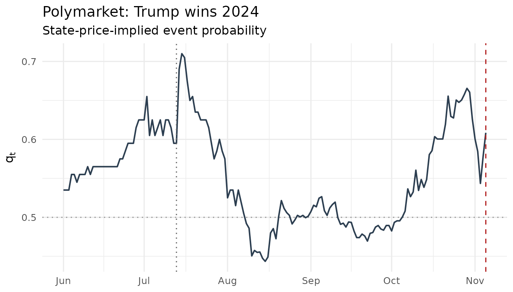

# Event betas: which assets move with the event probability?

``` r

library(eventclock)
```

## Which assets care about an event, and how much?

The Event Clock tells you how much news about an event arrived and when.
The natural next question is *who cares*: which stocks, currencies, or
indices move when the event probability moves, and by how much?

Think of an asset whose value would be \\\eta_1\\ times today’s value if
the event happens (outcome 1) and \\\eta_2\\ times today’s value if it
does not (outcome 2). Then a rise of \\\Delta q\\ in the event
probability moves the asset by about \\ r_t \\\approx\\ \Delta\eta
\\\Delta q_t, \qquad \Delta\eta = \eta_1 - \eta_2 . \\ We call
\\\Delta\eta\\ the asset’s **exposure** to the event: the gap between
its two possible values, as a fraction of today’s value. A regression of
daily returns on daily probability changes estimates it — that is
[`event_beta()`](https://www.sebastianstoeckl.com/eventclock/reference/event_beta.md).

**What you need:** the asset’s daily prices (a data frame with a `date`
column and an `adjusted`, `close`, or `price` column, or a `ret` column
with returns) and a daily event-probability series (an `event_prices`
object; collapse intraday prices with
[`pm_daily()`](https://www.sebastianstoeckl.com/eventclock/reference/pm_daily.md)).

## Trump Media and the 2024 election

The listed stock most exposed to the 2024 U.S. presidential election was
Trump Media & Technology Group (DJT). Both ingredients ship with the
package:

``` r

data(djt2024)
data(polymarket2024)
head(djt2024, 3)
#>         date close adjusted  volume
#> 1 2024-06-03 46.74    46.74 2580800
#> 2 2024-06-04 45.49    45.49 2659800
#> 3 2024-06-05 46.75    46.75 2116300

ep <- pm_daily(as_event_prices(polymarket2024,
  market_id = "Polymarket: Trump wins 2024",
  event_date = as.POSIXct("2024-11-05", tz = "UTC")
))

eb <- event_beta(djt2024, ep)
eb
#> -- Event-beta regression (Newey-West, 4 lags)
#> Event exposure deta_hat = 1.4669 (se 0.3728, t = 3.93), n = 125, R^2 = 0.106
#> Model-implied levels at mean q = 0.554: eta1 = 1.6549, eta2 = 0.1881
#> (No external deta supplied: levels/loading test not identified from returns alone.)
```

Reading the output: the estimated exposure is \\\widehat{\Delta\eta}
\approx\\ 1.47 with a t-statistic of 3.9 (Newey-West standard errors).
In words, a ten-point rise in Trump’s win probability moved DJT by about
15%. The \\R^2\\ of 0.11 says that about 11% of DJT’s daily return
variance over the sample came from election news — the rest is the
stock’s own (very large) volatility.

The probability is matched to each trading day by its last value on or
before that day, so news that breaks over a weekend enters Monday’s
return. The assassination-attempt weekend makes this visible in a single
observation:

``` r

fri <- as.Date("2024-07-12"); mon <- as.Date("2024-07-15")
c(dq_points = 100 * (ep$q[ep$time == mon] - ep$q[ep$time == fri]),
  return_pct = 100 * (djt2024$adjusted[djt2024$date == mon] /
                        djt2024$adjusted[djt2024$date == fri] - 1))
#>  dq_points return_pct 
#>   11.50000   31.36938
```

Between the Friday and Monday closes the win probability rose by about
11 points and the stock by about 31%.

``` r

plot_q(ep) +
  ggplot2::geom_vline(xintercept = as.Date("2024-07-13"),
                      linetype = 3, color = "grey40")
```



## What returns can and cannot tell you

Returns pin down the *gap* \\\Delta\eta\\, not the two values \\\eta_1\\
and \\\eta_2\\ separately. The levels in the output (\\\eta_1 \approx\\
1.65, \\\eta_2 \approx\\ 0.19) come from one extra assumption: on
average over the two outcomes, weighted by the event probability, the
asset should be worth what it is worth today, \\q\eta_1 + (1-q)\eta_2 =
1\\. They are implied by that assumption, not measured. Option prices
can measure them; see
[`vignette("eventclock-event-spanning")`](https://www.sebastianstoeckl.com/eventclock/articles/eventclock-event-spanning.md),
which describes the same exposure on a log scale, \\\theta =
\log(\eta_1/\eta_2)\\. The two are linked exactly by \\ \Delta\eta =
\frac{e^\theta - 1}{q\\e^\theta + 1 - q}. \\

**A cross-check against options.** If you have an exposure measured
elsewhere — for instance from option prices — pass it as `deta`.
[`event_beta()`](https://www.sebastianstoeckl.com/eventclock/reference/event_beta.md)
then reports \\\beta = \widehat{\Delta\eta}/\Delta\eta\\ and tests
\\\beta = 1\\: do returns move as much as the options imply? (Testing
against the regression’s own estimate would be circular.) As an
illustration, the accompanying working paper estimates from DJT options
expiring after the election (“event-spanning” options; see
[`vignette("eventclock-event-spanning")`](https://www.sebastianstoeckl.com/eventclock/articles/eventclock-event-spanning.md))
that the stock was worth about 2.71 times as much under a Trump win as
under a non-Trump outcome:

``` r

q_bar <- eb$q_mean
deta_options <- (2.71 - 1) / (q_bar * 2.71 + 1 - q_bar)
event_beta(djt2024, ep, deta = deta_options)
#> -- Event-beta regression (Newey-West, 4 lags)
#> Event exposure deta_hat = 1.4669 (se 0.3728, t = 3.93), n = 125, R^2 = 0.106
#> Model-implied levels at mean q = 0.554: eta1 = 1.6549, eta2 = 0.1881
#> Loading vs. external deta = 0.8785: beta = 1.670 (se 0.424), H0 beta=1: z = 1.58, p = 0.115
```

The option-implied exposure is smaller than the returns-based one, but
with this little data the test cannot reject \\\beta = 1\\.

## Does learning matter for the asset’s options? The relevance screen

An option that expires before the event gains value from the news that
arrives while it is alive. Four levers decide whether that matters: the
exposure (squared), how movable the probability still is
(\\\[q(1-q)\]^2\\, largest at 50%), the clock \\A\\ over the option’s
life, and the asset’s ordinary variance without the event (\\\sigma^2
\tau\\). Their ratio, \\ \rho = \frac{\[\Delta\eta\\ q(1-q)\]^2
A}{\sigma^2 \tau}, \\ is the variance from learning relative to ordinary
variance; the share of learning in total variance is \\\rho/(1+\rho)\\,
and
[`ec_iv_rule()`](https://www.sebastianstoeckl.com/eventclock/reference/ec_iv_rule.md)
translates it into implied-volatility points.

For DJT over the last two weeks before the election — using, for
simplicity, the clock that actually materialized (to price options in
real time, use a forecast; see
[`vignette("eventclock-measurement")`](https://www.sebastianstoeckl.com/eventclock/articles/eventclock-measurement.md))
and the volatility of returns net of election news as the ordinary
volatility:

``` r

A_2w <- event_clock(ep, from = as.Date("2024-10-22"),
                    to = as.Date("2024-11-05"), methods = "rv")$A
q_pre <- ep$q[ep$time == as.Date("2024-10-22")]

# ordinary volatility: daily returns net of the election component,
# annualized over 252 trading days; two weeks = 10 trading days
r  <- diff(log(djt2024$adjusted))
# probability on each trading day (last value on or before it),
# matched the way event_beta() matches it
qa <- ep$q[findInterval(as.numeric(djt2024$date), as.numeric(ep$time))]
sigma_ord <- stats::sd(r - eb$deta_hat * diff(qa)) * sqrt(252)
tau <- 10 / 252

djt <- list(deta = eb$deta_hat, q = q_pre, A = A_2w,
            sigma = sigma_ord, tenor = tau)
gbp <- list(deta = -0.012, q = 0.195, A = 0.166,
            sigma = 0.09325, tenor = 14 / 365)
screen <- function(x) c(
  rho = do.call(ec_relevance, x),
  learning_share = do.call(ec_variance_share, x),
  iv_points = 100 * do.call(ec_iv_rule, x)
)
rbind(`DJT, 2024 election` = screen(djt), `GBP, Brexit` = screen(gbp))
#>                            rho learning_share    iv_points
#> DJT, 2024 election 0.229954061    0.186961504 14.262199823
#> GBP, Brexit        0.001766033    0.001762919  0.008234127
```

For DJT, election learning was about 19% of the two-week variance —
worth roughly 14 implied-volatility points, clearly first-order for its
options. For the British pound around Brexit, with an exposure about a
hundred times smaller, the same calculation gives a rounding error. The
squared exposure decides who cares about the event.

## Practical notes

- With daily returns, collapse intraday probability data first
  ([`pm_daily()`](https://www.sebastianstoeckl.com/eventclock/reference/pm_daily.md));
  the probability is then matched to each trading day.
- Screen the probability series with
  [`ec_validate()`](https://www.sebastianstoeckl.com/eventclock/reference/ec_validate.md)
  and the sampling frequency with
  [`ec_signature()`](https://www.sebastianstoeckl.com/eventclock/reference/ec_signature.md)
  before interpreting exposures.
- Newey-West lags default to \\\lfloor 4(n/100)^{2/9} \rfloor\\; pass
  `lags = 0` for plain heteroskedasticity-robust errors.
- Add market or factor returns via `controls =` to separate the event
  channel from general market moves, e.g.
  `event_beta(djt2024, ep, controls = market)`, where `market` is a data
  frame with a `date` column and one column per daily market or factor
  *return* (not price).

## Where next

- [`vignette("eventclock-event-spanning")`](https://www.sebastianstoeckl.com/eventclock/articles/eventclock-event-spanning.md)
  — measuring the exposure from option prices, and pricing options that
  expire before the event;
- [`vignette("eventclock-brexit")`](https://www.sebastianstoeckl.com/eventclock/articles/eventclock-brexit.md)
  — other sources of event probabilities (fed funds futures, merger
  spreads).
