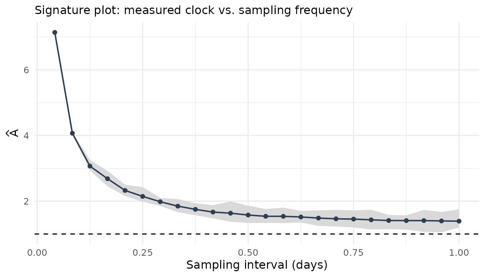

# Does the estimator work? Validation on simulated data

``` r

library(eventclock)
set.seed(42)
```

## Why validate

Before trusting the Event Clock on real data, a user should know: is it
biased when only about 30 daily prices are available? Are its confidence
intervals right? What do the robust variants measure when news arrives
in one big jump? How much does trading noise inflate it?

Real data cannot answer these questions because the true clock is
unknown. Simulated data can.
[`ec_simulate_path()`](https://www.sebastianstoeckl.com/eventclock/dev/reference/ec_simulate_path.md)
draws probability paths from the package’s model (the transition law in
the formula book of
[`vignette("eventclock-brexit")`](https://www.sebastianstoeckl.com/eventclock/dev/articles/eventclock-brexit.md))
with a *known* clock \\A\\, so any gap between estimate and truth is the
estimator’s doing. Throughout, \\L = \log\\q/(1-q)\\\\ are the log odds
of the event probability \\q\\, and the estimate is \\\widehat A = \sum
(\Delta L)^2\\, the sum of squared log-odds changes (`method = "rv"` in
[`event_clock()`](https://www.sebastianstoeckl.com/eventclock/dev/reference/event_clock.md)).

A small helper turns a simulated path into the package’s input format:

``` r

path_to_ep <- function(p) {
  as_event_prices(
    tibble::tibble(time = as.Date("2020-01-01") + p$step, q = p$q),
    clip = c(1e-8, 1 - 1e-8)   # switch off the default [0.01, 0.99] clipping
  )
}
```

## Bias and precision with few observations

For each window length we simulate 1000 paths with true clock \\A =
0.5\\ — a typical one-month value — and compute \\\widehat A\\ on each.
(The vectorized sum below is exactly what `event_clock(method = "rv")`
computes.)

``` r

A <- 0.5
reps <- 1000
grid <- c(15, 30, 60, 120, 250)
sims <- lapply(grid, function(n) {
  p <- ec_simulate_path(n_paths = reps, n_steps = n, q = 0.4, A = A)
  vapply(split(p$L, p$path), function(L) sum(diff(L)^2), numeric(1))
})
tab <- data.frame(
  n_obs = grid,
  mean = sapply(sims, mean),
  bias_pct = 100 * (sapply(sims, mean) / A - 1),
  theory_bias_pct = 100 * A / (4 * grid),
  mc_error_pct = 100 * sapply(sims, sd) / sqrt(reps) / A,
  sd = sapply(sims, sd)
)
knitr::kable(tab, digits = 3)
```

| n_obs |  mean | bias_pct | theory_bias_pct | mc_error_pct |    sd |
|------:|------:|---------:|----------------:|-------------:|------:|
|    15 | 0.514 |    2.718 |           0.833 |        1.195 | 0.189 |
|    30 | 0.506 |    1.162 |           0.417 |        0.834 | 0.132 |
|    60 | 0.501 |    0.151 |           0.208 |        0.562 | 0.089 |
|   120 | 0.500 |   -0.009 |           0.104 |        0.404 | 0.064 |
|   250 | 0.499 |   -0.132 |           0.050 |        0.287 | 0.045 |

The only systematic bias is tiny and known: given the outcome, the log
odds also drift a little toward it, which adds \\A^2/(4n)\\ to the
expected sum — under 1% here (`theory_bias_pct`). The measured bias lies
within about two simulation errors (`mc_error_pct`) of it. What short
windows cost is *dispersion* (`sd`): with 30 daily observations the
estimate typically misses by about a quarter of its value, which is why
interval estimates matter.

## Confidence intervals

`event_clock(se = TRUE)` adds a standard error, estimated from the sum
of fourth powers of the log-odds changes, and a confidence interval
built for \\\log A\\ and transformed back (so it stays positive and is
asymmetric). Do the intervals cover the truth as often as they claim?

``` r

coverage <- function(conf, n_steps, reps = 500, A = 0.5) {
  hits <- vapply(seq_len(reps), function(i) {
    p <- ec_simulate_path(n_paths = 1, n_steps = n_steps, q = 0.4, A = A)
    r <- event_clock(path_to_ep(p), methods = "rv", se = TRUE, conf = conf)
    r$ci_lo <= A && A <= r$ci_hi
  }, logical(1))
  mean(hits)
}
cov <- expand.grid(nominal = c(0.90, 0.95), n_obs = c(30, 60))
cov$empirical <- mapply(coverage, cov$nominal, cov$n_obs)
cov$mc_error <- 1.96 * sqrt(cov$nominal * (1 - cov$nominal) / 500)
cov
#>   nominal n_obs empirical   mc_error
#> 1    0.90    30     0.848 0.02629616
#> 2    0.95    30     0.918 0.01910372
#> 3    0.90    60     0.864 0.02629616
#> 4    0.95    60     0.950 0.01910372
```

Coverage is close to the nominal level, and in the shortest windows
somewhat below it: with 30 observations, the 95% interval covered the
truth in 91.8% of the replications, with 60 observations in 95%
(`mc_error` is the 95% simulation band around the nominal level). In
short windows, treat the intervals as slightly optimistic.

## The clock does not depend on the outcome

The clock measures *how much* was learned, not in which direction. Paths
that end with the event happening (\\J = 1\\) and paths that end without
it (\\J = 0\\) carry the same expected clock:

``` r

p <- ec_simulate_path(n_paths = 400, n_steps = 60, q = 0.4, A = 0.5)
qv <- vapply(split(p$L, p$path), function(L) sum(diff(L)^2), numeric(1))
J <- vapply(split(p$J, p$path), function(j) j[1], numeric(1))
data.frame(
  outcome = c("J = 1", "J = 0"),
  mean_A_hat = c(mean(qv[J == 1]), mean(qv[J == 0])),
  n_paths = c(sum(J == 1), sum(J == 0))
)
#>   outcome mean_A_hat n_paths
#> 1   J = 1  0.5048287     152
#> 2   J = 0  0.5027828     248
```

Both averages sit at the true \\A = 0.5\\. Constant or slowly moving
risk premia therefore do not bias the clock: they change how much weight
the market puts on each outcome, not how much the price moves along a
given path. Premia that fluctuate day to day can add to the measured
clock;
[`ec_recovery_set()`](https://www.sebastianstoeckl.com/eventclock/dev/reference/ec_recovery_set.md)
bounds that effect.

## Lumpy news: what the robust variants measure

Real news is lumpy — a debate or a verdict can move the price more in
one day than a month of polls. With `jump_share`, the simulator puts
part of \\A\\ into a few jump steps. Here half of the true clock (0.25)
arrives in a single jump and the other half (0.25) as a smooth flow:

``` r

lumpy <- lapply(seq_len(200), function(i) {
  p <- ec_simulate_path(n_paths = 1, n_steps = 60, q = 0.4, A = 0.5,
                        jump_share = 0.5, n_jumps = 1)
  event_clock(path_to_ep(p))[, c("method", "A")]
})
agg <- do.call(rbind, lumpy)
knitr::kable(
  aggregate(A ~ method, data = agg, FUN = mean),
  digits = 3,
  caption = "Mean estimate across 200 lumpy paths (true A = 0.5: 0.25 smooth + 0.25 in one jump)"
)
```

| method    |     A |
|:----------|------:|
| bipower   | 0.298 |
| largest1  | 0.239 |
| largest2  | 0.213 |
| rv        | 0.527 |
| truncated | 0.236 |

Mean estimate across 200 lumpy paths (true A = 0.5: 0.25 smooth + 0.25
in one jump) {.table}

`rv` recovers the total clock including the jump. `truncated` and
`largest1` land close to the smooth part (0.25): they drop the jump.
`bipower` dampens the jump without removing it entirely and sits in
between (0.298). `largest2` drops one ordinary move on top of the jump
and so sits a little lower than `largest1`. The ratio \\1 -
\text{bipower}/\text{rv}\\ is a simple *jumpiness index*, the share of
the clock that came in bursts — here 0.43, against a true jump share of
one half. None of the variants is wrong; they answer different
questions, and comparing them is the point.

## Trading noise and the sampling interval

Traded prices bounce between bid and ask on a coarse price grid. Such
noise adds about twice its variance to every measured change, so the
finer you sample, the more noise you add up. Here we add noise with a
standard deviation of 0.04 in log odds — roughly a one-cent bounce at a
price of 0.50 — to an hourly path with true clock \\A = 1\\:

``` r

p <- ec_simulate_path(n_paths = 1, n_steps = 2000, q = 0.4, A = 1)
noisy <- ec_ilogit(p$L + rnorm(nrow(p), sd = 0.04))
ep_noisy <- as_event_prices(
  tibble::tibble(time = as.POSIXct("2024-01-01", tz = "UTC") +
                   3600 * p$step, q = noisy),
  clip = c(1e-8, 1 - 1e-8)
)
plot_signature(ec_signature(ep_noisy, max_every = 24)) +
  ggplot2::geom_hline(yintercept = 1, linetype = 2)
```



At the finest spacing the measured clock is several times the truth
(dashed line); as the spacing grows it falls toward \\A = 1\\. Real data
show the same pattern — the hourly-versus-daily gap of the 2024
Polymarket series in
[`vignette("eventclock-measurement")`](https://www.sebastianstoeckl.com/eventclock/dev/articles/eventclock-measurement.md).
A daily snapshot
([`pm_daily()`](https://www.sebastianstoeckl.com/eventclock/dev/reference/pm_daily.md))
is therefore a conservative default, but it also misses genuine intraday
news: report more than one sampling interval.

## Where next

- [`vignette("eventclock-measurement")`](https://www.sebastianstoeckl.com/eventclock/dev/articles/eventclock-measurement.md)
  — sampling, real-time forecasts, and two venues on real data;
- [`vignette("eventclock-event-betas")`](https://www.sebastianstoeckl.com/eventclock/dev/articles/eventclock-event-betas.md)
  — which assets move with the event probability.
